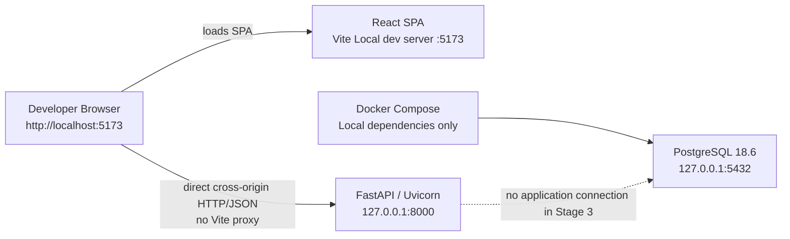

# Pathwise

## What Pathwise Is

Pathwise is a community-knowledge decision platform based on structured,
human-authored Decision Paths. The intended product flow is:

```text
User need
→ contextual questions
→ structured Decision Knowledge
→ relevant options
→ reasoning, trade-offs, and alternatives
```

Pathwise is not a shopping marketplace, ranking site, autonomous AI advisor, or
affiliate platform.

## Current Project Status

The repository currently represents the completed **Stage 3 — Project
Foundations & Local Development Environment**. Application behavior is
intentionally minimal. Stage 3 establishes and validates:

- an installable FastAPI Backend foundation;
- a React/Vite Frontend foundation;
- a Docker Compose-managed Local PostgreSQL dependency;
- Local configuration and secrets boundaries;
- direct browser-to-Backend health integration;
- Backend and Frontend quality/test baselines; and
- clean-checkout reproducibility once prerequisites are installed.

Stage 4 Product, Domain, and persistence behavior is not implemented yet.

## Local Architecture



Vite is a development server, not a Production server. PostgreSQL is available
for Local development but the Backend does not connect to it yet. AWS is not
required for the Local runtime.

## Repository Structure

```text
Pathwise/
├── README.md
├── AGENTS.md                  # Repository governance for implementation agents
├── compose.yaml               # Local PostgreSQL dependency
├── .env.example               # Local Compose configuration template
├── backend/
│   ├── pyproject.toml
│   ├── uv.lock
│   ├── src/pathwise/          # FastAPI application package
│   └── tests/                 # Backend foundation tests
├── frontend/
│   ├── package.json
│   ├── package-lock.json
│   └── src/                   # React application and tests
└── docs/
    ├── development.md         # Canonical Local developer guide
    └── stage-3-foundation.md  # Stage 3 engineering record
```

Generated environments, dependencies, build artifacts, and real Local `.env`
files are ignored and are not repository content.

## Prerequisites

The validated Stage 3 workflow assumes these prerequisites are already
installed:

- Git;
- uv `0.12.17`-compatible workflow and CPython `3.14.7` available through uv;
- Node.js `24.21.0` and npm `11.x`;
- Docker Engine and Docker Compose.

Stage 3 proves reproducible repository bootstrap after these prerequisites
exist. It does not prove installation on a blank workstation. WSL, Kubernetes,
Helm, AWS CLI, Terraform, and a host-installed PostgreSQL server are not needed
for current Local development.

## Quick Start

### 1. Clone and create Local configuration

Run from the parent directory in PowerShell:

```powershell
git clone <repository-url> Pathwise
Set-Location Pathwise

Copy-Item .env.example .env
Copy-Item backend\.env.example backend\.env.local
Copy-Item frontend\.env.example frontend\.env.local
```

Edit the root `.env` and assign a newly generated, disposable Local value to
`PATHWISE_POSTGRES_PASSWORD`. Do not use a shared or Production credential.

### 2. Restore locked dependencies

From `Pathwise/backend/`:

```powershell
uv sync --locked
```

From `Pathwise/frontend/`:

```powershell
npm ci
```

### 3. Start Local PostgreSQL

From the repository root:

```powershell
docker compose up -d
docker compose ps
```

Wait for the `postgres` service to report `healthy`.

### 4. Start the Backend

In a PowerShell window at `Pathwise/backend/`:

```powershell
uv run uvicorn pathwise.main:app --reload
```

### 5. Start the Frontend

In another PowerShell window at `Pathwise/frontend/`:

```powershell
npm run dev
```

Open <http://localhost:5173/> and activate **Check backend health**. The expected
result is `Backend health: ok`.

## Quality Validation

From `Pathwise/backend/`:

```powershell
uv run ruff check .
uv run ruff format --check .
uv run mypy src/pathwise
uv run pytest
```

The current Stage 3 baseline contains eight Backend tests.

From `Pathwise/frontend/`:

```powershell
npm run lint
npm run format:check
npm run test:run
npm run build
```

The current Stage 3 baseline contains eight Frontend tests. Test counts describe
the current baseline, not a permanent interface.

## Configuration and Secrets

Pathwise separates Local configuration by trust boundary:

- root `.env`: ignored Local Compose/PostgreSQL secret;
- `backend/.env.local`: ignored Backend application configuration;
- `frontend/.env.local`: ignored public browser configuration.

Their matching `.env.example` templates are tracked. Any `VITE_*` value is
browser-visible and must never contain a secret. See the
[Local Development Guide](docs/development.md) for the complete model.

## Documentation

- [Local Development Guide](docs/development.md)
- [Stage 3 Foundation Record](docs/stage-3-foundation.md)

## Current Scope and Deferred Work

The current repository does not yet implement persistence wiring, migrations,
Domain models, Product APIs/UI, authentication, AWS infrastructure, CI/CD, or
Production deployment. These are deferred roadmap concerns rather than rejected
directions. The Stage 3 record contains the bounded Stage 4 handoff.
