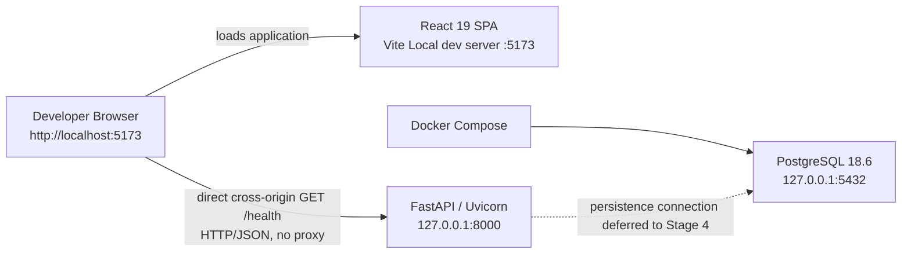

# Pathwise Stage 3 Foundation Record

This record describes the implemented and validated outcome of **Stage 3 —
Project Foundations & Local Development Environment**. It is an engineering
record, not a future-state design.

## 1. Stage 3 Implementation Summary

Stage 3 established:

- a human-governed monorepo foundation;
- an installable Python/FastAPI Backend package and application factory;
- a React/Vite JavaScript SPA foundation;
- PostgreSQL 18.6 as a Docker Compose-managed Local dependency;
- separated Local infrastructure, Backend, and public Frontend configuration;
- direct browser-to-Backend health integration with explicit CORS;
- bounded standard-library JSON application logging;
- Backend and Frontend linting, formatting, typing, and foundation tests;
- an LF repository text policy; and
- clean-checkout reconstruction from tracked templates and lockfiles.

No Stage 4 persistence or Product/Domain implementation was added.

## 2. Final Local Development Architecture



The Frontend and Backend are host processes. Compose orchestrates only the Local
PostgreSQL dependency. The dotted line is an explicit non-connection in the
current implementation.

Configuration remains separated across three Local surfaces:

```text
/.env                 → Local Compose secret
/backend/.env.local   → Backend application configuration
/frontend/.env.local  → public browser configuration
```

## 3. Final Project Structure

```text
Pathwise/
├── AGENTS.md                         # Durable human-governance rules
├── README.md                         # Repository entry point
├── compose.yaml                      # Local PostgreSQL service
├── .env.example                      # Local infrastructure template
├── .gitattributes                    # LF text policy
├── backend/
│   ├── .env.example                  # Backend Local configuration template
│   ├── .python-version               # CPython 3.14.7 marker
│   ├── pyproject.toml                 # Runtime, build, and quality metadata
│   ├── uv.lock                       # Exact Python dependency resolution
│   ├── src/pathwise/
│   │   ├── main.py                   # FastAPI composition root
│   │   ├── api/                      # HTTP API composition and health route
│   │   └── core/                     # Configuration and logging foundation
│   └── tests/                        # Stage 3 Backend foundation tests
├── frontend/
│   ├── .env.example                  # Public Vite configuration template
│   ├── .nvmrc                        # Node 24.21.0 marker
│   ├── package.json                  # npm scripts and dependency declarations
│   ├── package-lock.json             # Exact npm dependency resolution
│   ├── eslint.config.js              # ESLint Flat Config
│   ├── vite.config.js                # React/Vite and jsdom test configuration
│   └── src/
│       ├── main.jsx                  # Browser bootstrap
│       ├── app/                      # Application UI composition and tests
│       ├── api/                      # Browser API boundary and tests
│       └── test/                     # Vitest/Testing Library setup
└── docs/
    ├── development.md                # Canonical Local operations guide
    └── stage-3-foundation.md         # This engineering record
```

Generated environments, dependency trees, builds, caches, and Local `.env`
files are not tracked repository structure.

## 4. Toolchain Register

Versions were verified from repository metadata, lockfiles, and the validated
workstation toolchain on 2026-10-01.

| Area | Tool/library | Stage 3 version |
| --- | --- | --- |
| Backend runtime | Python | 3.14.7 |
| Backend workflow | uv | 0.12.17 |
| Backend runtime | FastAPI | 0.141.1 (locked) |
| Backend runtime | Uvicorn | 0.53.0 (locked) |
| Backend runtime | pydantic-settings | 2.15.0 (locked) |
| Backend quality | Ruff | 0.16.8 |
| Backend quality | mypy | 2.3.1 |
| Backend testing | pytest | 9.1.1 |
| Backend testing | httpx | 0.28.1 |
| Frontend runtime | Node.js | 24.21.0 |
| Frontend workflow | npm | 11.19.0 |
| Frontend runtime | React | 19.3.0 |
| Frontend runtime | React DOM | 19.3.0 |
| Frontend build | Vite | 8.3.1 |
| Frontend build | `@vitejs/plugin-react` | 6.1.1 |
| Frontend quality | ESLint | 10.10.0 |
| Frontend quality | Prettier | 3.9.9 |
| Frontend testing | Vitest | 5.0.2 |
| Frontend testing | React Testing Library | 16.3.3 |
| Frontend testing | Testing Library DOM | 10.4.2 |
| Frontend testing | jest-dom | 7.0.1 |
| Frontend testing | jsdom | 30.1.1 |
| Local data | PostgreSQL image | 18.6 |
| Local containers | Docker Engine | 29.8.1 (validated host) |
| Local containers | Docker Compose | 5.5.1 (validated host) |

The repository pins dependency graphs through `backend/uv.lock` and
`frontend/package-lock.json`; host prerequisite versions are not installed by
the repository.

## 5. Developer Workflow

The validated workflow is:

```text
copy tracked configuration templates
→ choose a disposable Local PostgreSQL password
→ restore Backend and Frontend dependencies from lockfiles
→ run both quality suites
→ start Local PostgreSQL
→ start the Backend
→ start the Frontend
→ validate direct browser health integration
```

See the [Pathwise Local Development Guide](development.md) for exact commands,
working directories, lifecycle behavior, and troubleshooting.

## 6. Configuration and Secrets Model

Stage 3 implements three trust boundaries:

1. Root Compose secret: ignored `/.env`, based on tracked `/.env.example`.
2. Backend configuration: ignored `/backend/.env.local`, based on tracked
   `/backend/.env.example`.
3. Frontend public configuration: ignored `/frontend/.env.local`, based on
   tracked `/frontend/.env.example`.

Production secrets are never committed or reused for Local development. The
Local PostgreSQL credential is disposable. Backend settings contain only the
current non-secret application values. `VITE_*` values are explicitly public
because they can be embedded in browser assets. AWS Secrets Manager is not
required for Local development.

## 7. Architecture Conformance Check

| Constraint | Stage 3 finding |
| --- | --- |
| Modular Monolith | Conformant. One FastAPI application/package; no microservices. |
| Frontend/Backend separation | Preserved. Static SPA direction and REST/HTTP/JSON API boundary remain separate. |
| Real PostgreSQL Local dependency | Implemented with `postgres:18.6`; no SQLite substitute. |
| Docker Compose role | Limited to Local PostgreSQL dependency orchestration. |
| Production Kubernetes/Helm | Not introduced. |
| AWS in Local Development | Not required or emulated. |
| Authentication | Cognito, authorization, and guest security remain deferred. |
| Persistence | PostgreSQL exists locally; application persistence remains deferred. |
| Search/cache/queues | No dedicated search, Redis/cache, worker, queue, or event bus introduced. |
| Local environment strategy | Behavioral parity without Production infrastructure identity. |
| Secrets | No Production credential tracked; Local real files are ignored. |
| Browser configuration | `VITE_*` is treated as public; no browser secret introduced. |

No Stage 3 architecture deviation was identified.

## 8. Decisions Made During Stage 3

| Decision | Implemented outcome |
| --- | --- |
| Repository organization | Monorepo with root `backend/` and `frontend/`. |
| Backend runtime | CPython 3.14.7, FastAPI, installable `src/pathwise` package. |
| Backend dependency workflow | uv, `pyproject.toml`, and committed `uv.lock`. |
| Backend entry pattern | Minimal `create_app()` plus module-level `app`. |
| Health contract | Shallow `GET /health` returning `{"status":"ok"}`. |
| Configuration | One cached pydantic-settings model with `PATHWISE_` prefix. |
| Logging | Bounded standard-library JSON logs to stdout. |
| Frontend runtime | Node 24.21.0, React 19, Vite, JavaScript/JSX. |
| Frontend dependency workflow | npm with committed `package-lock.json`. |
| Browser/API boundary | Native fetch directly to FastAPI; no Vite proxy. |
| Local database | PostgreSQL 18.6 through Compose with loopback binding and named volume. |
| Local CORS | Exact configurable Frontend origin; current methods limited to GET. |
| Local configuration | Separate root secret, Backend config, and public Frontend config surfaces. |
| Backend quality | Ruff, incremental mypy, pytest, and httpx TestClient support. |
| Frontend quality | ESLint Flat Config, React Hooks, Prettier, Vitest/jsdom, and Testing Library. |
| Repository text | LF enforced through root `.gitattributes`. |
| Reproducibility | Clean checkout must rebuild from tracked templates and lockfiles. |

These entries record Stage 3 implementation choices without replacing broader
architecture governance or ADRs.

## 9. Deferred Items

Stage 3 intentionally did not implement:

- SQLAlchemy 2;
- Psycopg 3 application integration;
- Alembic or a schema/migration workflow;
- database engine/session code or Pathwise tables;
- the Domain model or Decision Knowledge;
- Session execution, recommendation, feedback, or contribution workflows;
- Cognito, authentication, authorization, or guest capability security;
- localization or Hebrew/RTL behavior;
- Product UI, navigation, or routing;
- Dockerized Backend or Frontend runtimes;
- ECS/Fargate deployment or other AWS infrastructure;
- Terraform;
- GitHub Actions CI/CD;
- Trivy or a Production security pipeline;
- Playwright end-to-end testing;
- Production observability, metrics, tracing, or log shipping; and
- database backup/recovery procedures.

Deferred means scheduled for a later governed stage where applicable, not
rejected.

## 10. Stage 4 — Core Domain, Data and API Foundation

Stage 4 receives these completed prerequisites:

- an installable FastAPI Backend and explicit application factory;
- validated settings, bounded structured logging, API router composition, and
  explicit CORS;
- a shallow process health contract;
- Local PostgreSQL 18.6 with a persistent named volume;
- Backend and Frontend quality/test infrastructure;
- locked, reproducible Python and npm toolchains; and
- a clean-checkout bootstrap proven from tracked templates.

Expected Stage 4 concerns include SQLAlchemy 2, Psycopg 3, database
engine/session boundaries, Alembic, the initial schema and migration workflow,
the core Domain model, real PostgreSQL integration tests, and initial Domain/API
implementation.

This record does not select or implement those Stage 4 details. Open
architecture questions remain subject to the Pathwise human-governance process.
